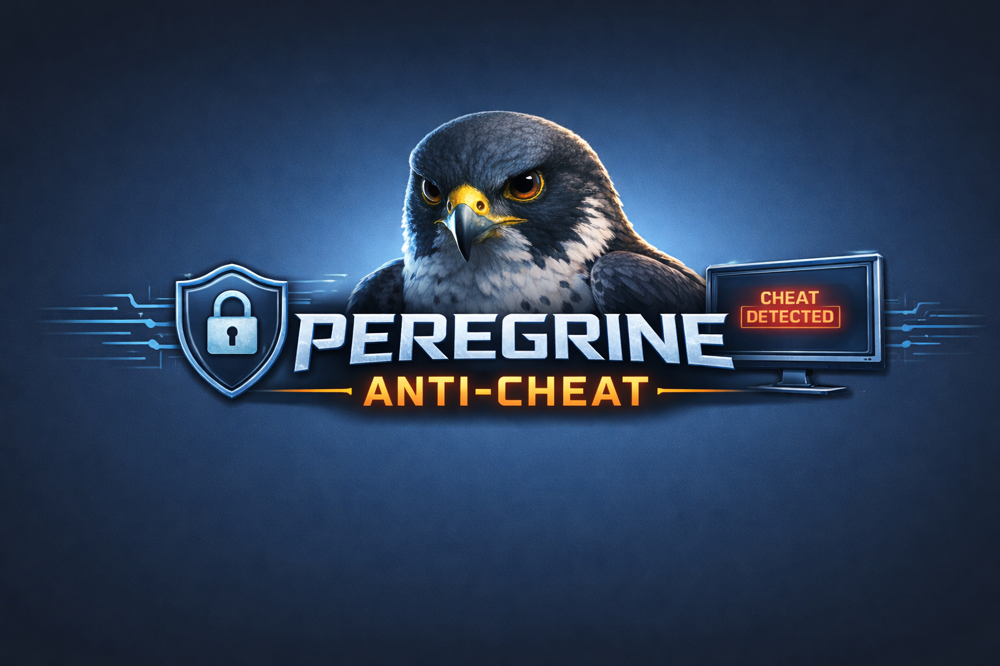

# Peregrine Anti-Cheat

An educational anti-cheat system demonstrating Windows kernel programming, process monitoring, and cheat detection.

<p align="center">
  
</p>

## Architecture

```
┌─────────────────────────────────────────────────────────────┐
│  Tauri GUI (Rust + Svelte)                                  │
│  peregrine-tauri.exe  (run elevated)                        │
│  ┌──────────┐ ┌──────────┐ ┌───────────┐ ┌──────────────┐   │
│  │ Driver   │ │ IPC Pipe │ │ Detection │ │ ETW-TI       │   │
│  │ Polling  │ │ Server   │ │ Scans     │ │ Consumer     │   │
│  └────┬─────┘ └────┬─────┘ └───────────┘ └──────────────┘   │
│       │IOCTL       │Named Pipe                PPL+ETW       │
├───────┼────────────┼────────────────────────────────────────┤
│       ▼            ▼                                        │
│  ┌─────────────────────────────────────────────────────┐    │
│  │  Kernel Driver (Minifilter)                         │    │
│  │  PeregrineKernelComponent.sys                       │    │
│  │  • ObCallback (process + thread handles)            │    │
│  │  • Thread/Image notify (protected PIDs)             │    │
│  │  • APC DLL inject (Game + Sensor profiles)          │    │
│  │  • PPL elevation (EPROCESS patch)                   │    │
│  │  • Minifilter (report + deny AC file tamper)        │    │
│  │  • Driver/ObCallback scanning                       │    │
│  │  • HWID collection (disk serial, boot GUID)         │    │
│  │  • VAD scan (executable private memory)             │    │
│  └─────────┬───────────────────────────────────────────┘    │
│            │ APC Injection (per-role DLL path)              │
│     ┌──────┴──────┐                                         │
│     ▼             ▼                                         │
│  Game DLL      Sensor DLL                                   │
│  (game.exe)    (cheat.exe)                                  │
│  • full hooks  • external hooks                             │
│  • VEH/HWBP    • callstack                                  │
│  • auto-protect• no auto-protect                            │
└─────────────────────────────────────────────────────────────┘
```

| Component | Language | Role |
|-----------|----------|------|
| **Kernel Driver** | C (Minifilter) | Ring-0: ObCallbacks, dual-profile APC injection, PPL, notify, file defense, scans, HWID, VAD |
| **Game DLL** | C++ (MinHook) | Inject into **game**: full API hooks + VEH / hardware-breakpoint detection + callstack; inject success → auto-protect |
| **Sensor DLL** | C++ (MinHook) | Inject into **cheats/tools**: external API hooks + callstack; **no** VEH/HWBP detection; **no** auto-protect |
| **Tauri GUI** | Rust + Svelte | Userland: IOCTL, IPC, scans, ETW-TI, dual inject target lists |

**Communication flows:**
- **GUI ↔ Driver**: IOCTL commands (PIDs, Game/Sensor inject config, scans) + event polling. The poll doubles as a **heartbeat**: the first failed round-trip raises a sticky "KERNEL COMPONENT OFFLINE" banner. Polling starts only after the UI has registered its listeners, so events queued in the kernel while no GUI was running (and the overflow notice) are shown, not discarded
- **DLL → GUI**: Named pipe `\\.\pipe\peregrine_ipc` (`hello`, hooks, VEH/HWBP findings on Game). Every client is authenticated by its real PID against the kernel's inject records; `callerPID` / `role` are stamped by the GUI, not taken from the message
- **Driver → target**: APC at `kernel32` load; **Game** success auto-protects PID; **Sensor** does not
- **GUI → ETW**: PPL-protected real-time session for Threat Intelligence (start/stop in UI)

## ETW-TI consumer

Provider: `Microsoft-Windows-Threat-Intelligence` (`{f4e1897c-bb5d-5668-f1d8-040f4d8dd344}`).

| Requirement | Detail |
|-------------|--------|
| Elevation | GUI elevated |
| PPL | Kernel `set_ppl` on GUI PID before `EnableTraceEx2` |
| Scope | Only events tied to **protected game PIDs** (external target, or internal interesting) |

**Parsing (correct path):** fields via **TDH** (`TdhGetProperty` / `TdhGetPropertySize`) by name (`CallingProcessId`, `TargetProcessId`, `BaseAddress`, `RegionSize`/`ViewSize`/`BytesCopied`, `ProtectionMask`, `LastProtectionMask`, …). No hardcoded `UserData` offsets (Version / FILL_VAD / build-safe). Classify with Keyword + Task; caller falls back to `EventHeader.ProcessId`. Keyword enable mask is `u64::MAX`.

**UI policy (game-centric, VM-verified):**

- **Log only EXTERNAL** ops where `target_pid ∈ protectedPids` (cheat → game)
- **Drop all local** (`caller == target`) — Game DLL MinHook is game→game noise (ALLOC 0x1000 RWX, PROTECT size≈5 RX↔RWX)
- **Drop system callers** (csrss, powershell, explorer, svchost, …) — process-create chatter
- Severity: `!!` critical / `!` high / `[X]` executable; READVM rate-limited ~1/2s

**Ops:** Toggle **ETW-TI** / **ETW stop** (re-start after stop works). Start ETW **before** running cheats.

**VM smoke:** Game inject + ETW-TI → `test\cheat_etwti.exe <game_pid>`  
Expect clean lines only, e.g.:
```
!! WRITEVM_REMOTE   cheat_etwti → game | addr size=0x13
!! PROTECTVM_REMOTE [X] cheat_etwti → game | addr size=0x1000 prot=0x40 was=0x4
!  SUSPEND_THREAD / RESUME_THREAD cheat_etwti → game
```

## Detection scope

Peregrine reports only what concerns a **protected game process**, plus its own self-defense:

- **EXTERNAL** — an operation that targets the game (`target ∈ PROTECTED`)
- **INTERNAL** — an anomaly inside the game process (`host ∈ PROTECTED`)
- everything else is ignored — no system-wide noise

Two kernel PID sets with different meanings (`AppState.h`), never interchangeable:

| Set | Meaning | Set by | Grants |
|-----|---------|--------|--------|
| **PROTECTED** | "we defend this process" (the game) | GUI **Add**, or a successful Game inject | nothing — it only scopes detections |
| **TRUSTED** | "this process is us" (the GUI) | IOCTL `18`, only for the calling process itself, **one process at a time** | the only process the control device answers; exempt from ObCallback reports and from the AC file self-defense |

A protected process is **not** trusted: the game (or anything that got itself protected) cannot touch AC files and its handle opens on other protected processes are reported like anyone else's.

Trust is exclusive: the first process to ask holds it until it exits, everybody else gets `ACCESS_DENIED` — for the trust request and for every other IOCTL (commands, event polling, state queries). An elevated cheat can open the device but cannot reconfigure the driver, make itself trusted or read its events. If something else grabbed trust before the GUI started, the GUI says so instead of running half-working.

The kernel is the source of truth for what is protected and injected. A GUI that (re)starts reads that state back (`QUERY_STATE`) instead of pushing its own lists.

Rate limits sit on the **report**, never on the detection, and always carry a `suppressed` count; event-queue overflow is reported as `coms_overflow`. Nothing is dropped silently.

### Known limits (honest list)

- **Direct syscalls bypass the DLL hook layer entirely.** The MinHook hooks only see callers that go through `ntdll` / `KernelBase` prologues. ObCallback (handles) and ETW-TI are the sensors that survive this; an instrumentation-callback detector is not implemented yet.
- **A driver stop can be requested** (`sc stop`) by an administrator. While the GUI runs, its open device handle keeps the stop pending: the driver stays loaded and fully working, and the GUI shows a "STOP PENDING" banner (it asks the service manager once a second). The unload completes the moment the GUI exits or is killed — this is *detected* and *delayed*, not *prevented*.
- **Driver trust is first-come.** A process that asks for trust before the GUI does gets it; the GUI then refuses to run and reports it, but the race itself is not prevented (it would take verifying the requestor's image signature).
- **VEH / hardware-breakpoint detection polls.** An unbacked handler registered through the API is reported immediately; one linked into the list by hand, and breakpoints set from another process, are seen by the 2 s scan — something set and removed within that window is missed. A handler placed inside a loaded image (e.g. a code cave in a legitimate DLL) is not flagged by this check.
- **File self-defense is by name.** It covers the AC files inside a directory named `Peregrine` and that directory itself; renaming a *parent* directory is not covered, so deploy directly under a volume root (`C:\Peregrine`).
- **Scans are on demand** (Modules, IAT/EAT, Threads, VAD, YARA, Blacklist, Overlay). A cheat that acts between two button presses is not seen by them.
- **Name-based checks remain** in the process/driver blacklists, the ETW-TI system-caller filter and the AC file list (`\Peregrine\<name>`); renaming defeats the blacklists.
- **Overlay detection** only sees separate top-level windows, not rendering hooked into the game's own swapchain.
- `rules.yar` is a demonstration rule for the test tools, not a signature set.

## Detection Capabilities

| # | Detection | Technique |
|---|-----------|-----------|
| 1 | **Module Integrity** | `.text` section SHA-256: disk vs memory, relocation-aware; PeregrineDLL MinHook sites are excluded only if their detour **verifiably ends in our own DLL** (logged as `ok self-hooks`) — a foreign hook on the same export is tamper |
| 2 | **IAT/EAT Hook Detection** | PE import/export table scanning for entries outside known modules |
| 3 | **External Memory Access** | **Sensor DLL** (in cheat) and/or Game DLL hooks: NtRead/NtWriteVirtualMemory (covers RPM/WPM, one event per op), VirtualAllocEx/VirtualProtectEx/CreateRemoteThread/OpenProcess; also ObCallback + ETW-TI without any DLL. Bypassed by direct syscalls |
| 3b | **Call Stack Validation** | `RtlCaptureStackBackTrace` on every hooked call (never rate-limited — only the report is) — flags callers in `MEM_PRIVATE` executable memory |
| 4 | **Thread & Shellcode Detection** | Kernel `thread_create` (start address) + userland scan: suspend → `GetThreadContext` → RIP/start vs modules |
| 5 | **Handle Access Monitoring** | Kernel ObCallback on **process and thread** handle create/duplicate with dangerous access (incl. `VM_READ`, thread `SET_CONTEXT`/`SUSPEND_RESUME`, `MAXIMUM_ALLOWED`); per caller→target report rate limit with `suppressed` count |
| 6 | **Process Blacklist** | Keyword scan against running process paths |
| 7 | **Driver Blacklist** | Ring-0 enumeration of loaded kernel drivers |
| 8 | **ObCallback Enumeration** | Ring-0 scan of registered object callbacks |
| 9 | **Manual-Map / VAD** | Kernel `ZwQueryVirtualMemory` walk — executable private regions; the Game DLL's own MinHook trampoline page is recognised by following the verified hook sites, not by address or by anything the game claims |
| 10 | **Overlay Detection** | `EnumWindows` for layered / transparent / topmost+near-fullscreen windows |
| 11 | **System Integrity** | Test-signing, HVCI, CPU vendor/hypervisor detection |
| 12 | **ETW Threat Intelligence** | PPL + **TDH** property parse; UI shows **external→game** only (WRITE/PROTECT/SUSPEND…); drops game→game MinHook noise and system callers |
| 13 | **File Self-Defense** | Minifilter reports **and denies**, for every non-TRUSTED user-mode process: write/delete/rename of AC artifacts under `\peregrine\` (including through alternate data streams and opens by file ID), rename / hard-link **onto** them, hard links **from** them (a second, unprotected name), and rename/delete of the AC directory itself |
| 14 | **HWID Collection** | Hybrid kernel+userland fingerprinting |
| 15 | **YARA Memory Scanning** | yara-x over process address space (`rules.yar`) |
| 16 | **VEH / Hardware-Breakpoint Detection** | **Game DLL**: hook on `RtlAddVectoredExceptionHandler` + periodic walk of the VEH list report handlers that are not inside a loaded image; a watchdog reports every game thread with an enabled hardware breakpoint, and the `NtSetContextThread` hook the in-process call that sets one. Nothing in the game is modified for this (no own breakpoints) |

## Dual inject DLLs (Game vs Sensor)

| | **Game** | **Sensor** |
|--|----------|------------|
| Deploy names | `PeregrineGame_x64/x86.dll` | `PeregrineSensor_x64/x86.dll` |
| Inject targets | Full image path of the game | Full image path of the cheat / tool |
| Hooks | Full set (NtRead/NtWrite/VAEx/…/OpenProcess) + `NtSetContextThread` + `RtlAddVectoredExceptionHandler` | Same external hooks; **no** `NtSetContextThread` / VEH hook |
| VEH / hardware-breakpoint detection | Yes | No |
| Callstack on hooks | Yes | Yes |
| Auto-protect (PROTECTED, never TRUSTED) | Yes (on inject success) | **No** |
| IOCTL paths | 8 (x64), 9 (x86) | 15 (x64), 16 (x86) |
| IOCTL add target | 10 | 17 |

**GUI:** Connect loads both path pairs. Enter the **full path** of the executable and use **Game** / **Sensor**; **Clear Inj** clears both lists (IOCTL 14).

**Target identity is the full image path, never the file name.** The GUI resolves the path to its normalized NT form (`\Device\HarddiskVolumeN\…\game.exe`) and the driver compares it with the FltMgr-normalized name of the image being started. A cheat renamed to `game.exe` in another directory is neither injected nor protected.

**Verified flow (Windows 10 22H2 VM, x64 and x86/WoW64 targets, driver under Driver Verifier):** Game inject `C:\test\game.exe` → `apc_inject` `role=game` + `[VEH Guard] active` + auto-protect; the same binary started from another directory is neither injected nor protected; Sensor inject `cheat.exe` → `role=sensor` (not protected); `cheat.exe` RPM/WPM against the game → external IPC from Sensor, against an unprotected process → nothing.

## Kernel APC DLL Injection

OpenEDR-style user-mode APC (no private shellcode):

1. GUI sets **Game** and **Sensor** DLL paths and separate target **path** lists via IOCTL  
2. Driver matches the normalized image path on process create (Game list first, then Sensor). When the process' own loader maps the system `kernel32.dll` (`\Windows\System32` or `\Windows\SysWOW64`, on a thread of that process — a section mapped in by another process does not count), the load-image callback only queues a **kernel-mode APC** to that thread. Its normal routine runs at `PASSIVE_LEVEL` once the mapping has completed and does the actual work (a load-image callback must not touch user virtual memory): it queues the user APC with:
   - `NormalRoutine` = `LoadLibraryExW` (from `KernelBase` if it is already in the loader list, otherwise the `kernel32` export)
   - `NormalContext` = full wide path for that **role** in target VA (`PAGE_READWRITE` only)
   - `SystemArgument1` = `NULL`, `SystemArgument2` = load flags (`0` for absolute paths under `C:\Peregrine\`)
3. **No `KeTestAlertThread`** — APC is delivered by the loader’s later `NtTestAlert` after static imports are initialized (forcing delivery in `LoadImageNotify` crashes the process)
4. The path buffer is never freed by the driver (it lives in the target's address space and goes away with the process; freeing earlier could race the load)  
5. On **Game** inject success, kernel adds the PID to PROTECTED so ObCallback / thread / image notifies apply immediately (`"protected": false` in the event if the set is full). **Sensor** inject does not protect the host PID.  
6. x64 + x86 WoW64 (`PsWrapApcWow64Thread` in the APC kernel routine)
7. Everything read from the target's address space for this (PEB loader list, PE export tables) is range-checked against the user address space and bounded — the target controls that memory
8. Each queued APC holds a rundown reference; `DriverUnload` waits for them, so the image is never unmapped under a pending APC

Approach adapted from [OpenEDR](https://github.com/ComodoSecurity/openedr) injectengine (`apcinjector` / `apcqueue`). No RX inject staging (path buffer is RW only).

**VAD after inject:** the Game DLL's MinHook trampolines live in a small private `EXECUTE_READWRITE` page, which is exactly what a VAD scan looks for. The GUI identifies that page by following the hooks it has verified (hooked export → relay → detour inside our DLL; on x86, the trampoline's jump back into the hooked export) and logs it as `Peregrine's own hook trampolines`; every other executable private region is reported. The inject path itself allocates no executable memory.

**Module integrity after inject:** `ntdll` / `KernelBase` (and optionally `kernel32`) fail a naive disk-vs-memory `.text` hash because the Game DLL patches API prologues. The checker masks those export sites (same list as `dllmain.cpp` hooks) — but only where the patched prologue really jumps into our own DLL, loaded from the GUI's directory — and re-hashes; everything else is reported as **tamper**. UI shows `[ok self-hooks] … (MinHook excluded)` when the only diffs were verified self-hooks.

**IOCTL notes:** command `14` clears **all** injection targets (Game + Sensor) and disables injection. Commands `10` / `17` take the target's NT path (UTF-16LE). Command `18` trusts the calling process (exclusive, see *Detection scope*) and is the only request an untrusted process may send. `0x803` (`QUERY_INJECTED`) answers whether the kernel injected a given PID and with which role; `0x804` (`QUERY_STATE`) returns the protected PIDs and inject targets as JSON. A rejected command fails the IOCTL with its NTSTATUS — the GUI no longer assumes success. Full list: `COMS_COMMAND` in `Coms.h`.

## Security model (educational)

| Surface | Policy |
|---------|--------|
| Device `\\.\Peregrine` | `IoCreateDeviceSecure` — **SYSTEM + Administrators** may open it; every request except the trust request is answered only for the one TRUSTED process |
| IPC pipe | SYSTEM + Administrators full; **Authenticated Users** write-only and **without** `FILE_CREATE_PIPE_INSTANCE` (nobody else can serve the pipe name). Created with `FILE_FLAG_FIRST_PIPE_INSTANCE`, inbound-only, remote clients rejected. Connecting proves nothing: each client PID must be a process the kernel injected, otherwise it is disconnected unread. An authenticated client is still treated as hostile (a Sensor target *is* the cheat): per-connection rate limit, bounded queue, connection cap, and the connection ends when the authenticated process exits. Drops are reported (`IpcFlood`). |
| Kernel sets | PROTECTED ≠ TRUSTED (see *Detection scope*). TRUSTED only via IOCTL `18` for the caller itself, one process at a time. |
| Injected DLL | Hooks never block the host: pipe writes have a 250 ms deadline and back off when the GUI is absent or not reading; undelivered messages are counted and announced (`IpcDropped`). Hooks preserve the caller's last-error value. |
| Injected DLL path | The GUI hands the kernel only DLLs found next to its own executable (the directory the file self-defense covers). |
| GUI | Must run **elevated** |
| Kernel JSON | Paths escaped in-kernel (`JsonEscapeString`); no userland `\` massaging |

## Building

```batch
build_dll.bat                              # Game+Sensor DLLs + driver → Userland + C:\Peregrine\
cd src\peregrine-tauri && npx tauri build  # use tauri build (not cargo alone) so the UI embeds
copy src\peregrine-tauri\src-tauri\target\release\peregrine-tauri.exe C:\Peregrine\
```

**Requirements:** Windows 10/11 x64, VS2022 + WDK, Rust 1.70+, Node.js 18+, test signing enabled

**Deploy layout (typical VM):**
```
C:\Peregrine\
  PeregrineKernelComponent.sys
  PeregrineGame_x64.dll
  PeregrineGame_x86.dll
  PeregrineSensor_x64.dll
  PeregrineSensor_x86.dll
  peregrine-tauri.exe
  rules.yar
```

## Usage

```
sc.exe create Peregrine type= kernel binPath= "C:\Peregrine\PeregrineKernelComponent.sys"
reg add "HKLM\SYSTEM\CurrentControlSet\Services\Peregrine\Instances" /v "DefaultInstance" /d "Peregrine Instance" /f
reg add "HKLM\SYSTEM\CurrentControlSet\Services\Peregrine\Instances\Peregrine Instance" /v "Altitude" /d "370030" /f
reg add "HKLM\SYSTEM\CurrentControlSet\Services\Peregrine\Instances\Peregrine Instance" /v "Flags" /t REG_DWORD /d 0 /f
sc.exe start Peregrine
C:\Peregrine\peregrine-tauri.exe
```

1. Connect (finds the Game + Sensor DLLs next to the EXE)  
2. **Game** button: full path, e.g. `C:\test\game.exe` → start game → `apc_inject` with `role=game` + auto-protect  
3. **Sensor** button (optional): full path, e.g. `C:\test\cheat.exe` → sensor hooks for outbound APIs (no protect)  
4. Run cheats / scans (Threads, VAD, Overlay, ETW-TI, …)

## Test Suite

Purpose-built tools in `test/`:

| Cheat | Technique | Detected by |
|-------|-----------|-------------|
| `cheat.exe <PID> <addr>` | RPM/WPM | Sensor DLL hooks (if inject), ETW-TI, ObCallback |
| `cheat_inject.exe <PID> payload.dll` | Remote LoadLibrary | ObCallback, hooks, ETW-TI |
| `cheat_shellcode.exe <PID>` | RWX private + remote thread (CFG-safe spin loop) | Thread scan, VAD, ETW-TI, ObCallback |
| `cheat_patch.exe <PID>` | NOP in kernel32 `.text` | Module integrity, ETW-TI |
| `cheat_manualmap.exe <PID>` | Private exec ± PE header | VAD |
| `cheat_yara.exe <PID>` | Marker strings / blob | YARA |
| `cheat_callstack.exe <PID>` | OpenProcess from private RWX | Callstack anomaly |
| `cheat_etwti.exe <PID>` | Alloc/WPM/RPM/ProtectEx + Suspend/Resume remote | **ETW-TI** (start ETW before running) |
| `cheat_thread.exe <PID> [n]` | `OpenThread(SET_CONTEXT\|SUSPEND_RESUME)` without a process handle; `n` loops to show the report rate limit | ObCallback (thread handles) |
| `cheat_pipe.exe [PID]` | Forged DLL telemetry written to the IPC pipe | Must be **rejected**: disconnected, no log line |
| `cheat_hwbp.exe <PID>` | FakeVEH (remote thread registers a handler that lives in injected memory) + hardware breakpoints on every game thread | `[VEH TAMPER]` (registration hook + list scan), `[HW BREAKPOINT]` |
| `cheat_file.exe [dir]` | Nine ways to modify an AC file: write, `::$DATA`, alternate stream, open by file ID, hard link, delete, rename, replace-by-rename, rename the directory | Must all be **refused** (tool prints PASS), minifilter reports |
| `cheat_ioctl.exe` | An elevated process sending IOCTLs to the driver: trust itself, unprotect the game, disable injection, read events / state | Must all be **refused** (tool prints PASS) |
| `CheatEngine.exe` | Exists | Blacklist |

Start `game.exe` first — it prints PID and a health address. `game.exe --veh` / `--veh-last` / `--veh-main` additionally register (image-backed, i.e. legitimate) vectored exception handlers from new threads or the main thread every 10 s: the game must keep running and nothing may be reported.

All of the above was run against x64 and x86 (WoW64) builds of `game.exe` with the driver under Driver Verifier (special pool + forced IRQL checking).

**Note:** Older shellcode demos that `call Sleep` from private memory can **CFG FastFail** the whole target process. The current `cheat_shellcode` uses a no-API spin loop so the game stays alive for Thread/VAD checks.

## Components

```
src/
├── PeregrineKernelComponent/    # Kernel minifilter driver (ring-0)
├── PeregrineDLL/                # Game + Sensor inject DLLs (x86 + x64, role builds)
└── peregrine-tauri/             # Rust/Tauri desktop GUI
test/                            # Cheat test tools
```

## Blog Posts

Accompanying series on [patchi.fyi](https://patchi.fyi):

- [Anatomy of an Anti-Cheat](https://patchi.fyi/blog/peregrine-anatomy-of-an-anticheat/)
- [ObCallbacks](https://patchi.fyi/blog/peregrine-obcallbacks/)
- [Kernel APC Injection](https://patchi.fyi/blog/peregrine-kernel-apc-injection/)
- [MinHook API Interception](https://patchi.fyi/blog/peregrine-minhook-api-interception/)
- [Game vs Sensor Multi-DLL](https://patchi.fyi/blog/peregrine-multi-dll-game-sensor/)
- [Relocation-Aware Hashing](https://patchi.fyi/blog/peregrine-relocation-aware-hashing/)
- [IAT/EAT Scanning](https://patchi.fyi/blog/peregrine-iat-eat-scanning/)
- [Shellcode Thread Analysis](https://patchi.fyi/blog/peregrine-shellcode-thread-analysis/)
- [PPL ETW Threat Intelligence](https://patchi.fyi/blog/peregrine-ppl-etw-threat-intelligence/)
- [Minifilter Self-Defense](https://patchi.fyi/blog/peregrine-minifilter-self-defense/)
- [Kernel Scanning](https://patchi.fyi/blog/peregrine-kernel-scanning/)

## Disclaimer

**Strictly for educational purposes.** Use only in controlled environments with proper authorization.
